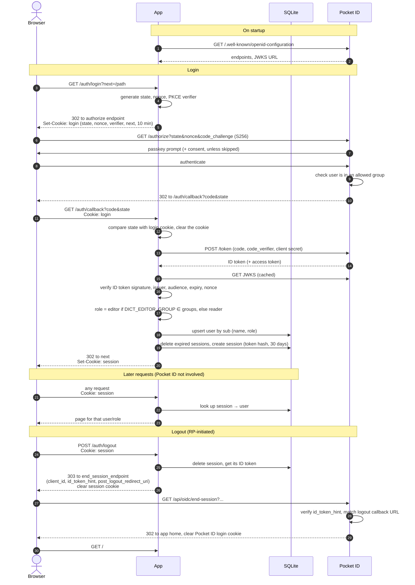

# Setting up Pocket ID

The app logs in through [Pocket ID](https://pocket-id.org) over OIDC. Roles
come from Pocket ID groups, so all user management happens there.

Examples below use `https://dict.example.com` as the app's public URL.

## OIDC client

Create a client in Pocket ID (Administration → OIDC Clients):

| Field                      | Value                                       | Why                                                                                             |
| -------------------------- | ------------------------------------------- | ----------------------------------------------------------------------------------------------- |
| Name, Description, Logo    | anything                                    | Shown in Pocket ID only.                                                                        |
| Client Launch URL          | `https://dict.example.com/`                 | Used by Pocket ID's "My Apps" page.                                                             |
| Callback URLs              | `https://dict.example.com/auth/callback`    | Must be exactly `DICT_BASE_URL` + `/auth/callback`.                                             |
| Logout Callback URLs       | `https://dict.example.com/`                 | Must be exactly `DICT_BASE_URL` + `/`: where Pocket ID sends the user back after logout.        |
| Public Client              | **off**                                     | The app is a server-side (confidential) client and keeps the secret.                            |
| PKCE                       | **on**                                      | The app always sends a PKCE challenge; this makes Pocket ID require it.                         |
| Requires Re-Authentication | off                                         | Would only add a passkey prompt per login; app sessions last 30 days anyway.                    |
| Skip Consent Screen        | on (optional)                               | First-party app, the consent screen adds nothing. If off, each user approves it once.           |

After saving, copy the client ID and secret into the app's env file (see
[`deploy/env.example`](../deploy/env.example)):

```sh
DICT_BASE_URL=https://dict.example.com
DICT_OIDC_ISSUER=https://id.example.com      # Pocket ID base URL
DICT_OIDC_CLIENT_ID=...
DICT_OIDC_CLIENT_SECRET=...
```

For local testing against Pocket ID, add a second callback URL
`http://localhost:8080/auth/callback` and logout callback URL
`http://localhost:8080/`, and run with `DICT_BASE_URL=http://localhost:8080`.

## Groups

1. **Editors.** Create a group whose *name* (not the display name) is
   `dictionary-editors`, or whatever `DICT_EDITOR_GROUP` is set to. Members
   become editors; everyone else is a reader.
2. **Allowed groups.** In the client's settings, restrict it to allowed
   user groups. **Do this**: the app lets in anyone Pocket ID authenticates
   as at least a reader. Allow e.g. a `dictionary` group with the whole
   family, plus `dictionary-editors` (editors must be allowed to log in too).

A role is refreshed only on login: after changing someone's groups, they
need to log out and back in.

## What the app requests

Scopes `openid profile groups`. Claims used:

- `sub`: user identity;
- `name`, falling back to `preferred_username`: shown as the author of
  entries;
- `groups`: editor role.

## How login works

Authorization code flow with PKCE. The app is a confidential client: the
code exchange happens server-to-server with the client secret.



- **state** ties the callback to the browser that started the login (CSRF);
  **nonce** ties the ID token to it (replay); the **PKCE verifier** makes a
  stolen code useless without it. All three live only in the `login` cookie.
- The access token is discarded: the app needs nothing beyond the ID token
  claims. The raw ID token is kept in the session row, only to be sent back
  as `id_token_hint` on logout.
- Logout is RP-initiated: after deleting its own session the app sends the
  browser to Pocket ID's `end_session_endpoint`, which ends the Pocket ID
  login and redirects back to the app's home page. So the next login, to any
  app using Pocket ID, needs a passkey again. Other apps' own sessions stay:
  Pocket ID doesn't notify them.
- Without a valid `id_token_hint` Pocket ID asks the user to confirm instead
  of redirecting back. Sessions without an ID token (created before 0.2.0)
  therefore log out locally only.

## Checking it works

Log in: your name should appear in the header, and editors should see
«Добавить». If an editor sees no «Добавить», the `groups` claim didn't come
through or the group name doesn't match `DICT_EDITOR_GROUP`.

Log out: you should land back on the app's home page, and opening Pocket ID
should ask for a passkey. If Pocket ID shows a «Sign out» confirmation
instead, the logout callback URL doesn't match `DICT_BASE_URL` + `/`.
